# StarSI

**A private, local-first LLM you can think with — served from your own hardware to your phone.**

StarSI is a personal inference system built around one goal: a technically knowledgeable discussion partner that generates genuinely new ideas, runs entirely on hardware you own, and is reachable from an iPhone over proximity-based networking. No cloud, no third-party weights hosting, no conversation leaving the LAN.

This README captures the design as of October 2026. Nothing below is implemented yet; it is the spec the code will be built against.

---

## Goals and priorities

In order:

1. **Idea generation over pleasantness.** The model should surface non-obvious, mechanistically specific, cross-domain ideas. A polished but predictable answer is a failure.
2. **Technical depth.** Discussions will range across STEM and beyond; the model must hold its own on technical claims and attach confidence to them.
3. **A discussion partner with positions, not a pure questioner.** Socratic in method, but it eventually asserts and defends a view, and changes its mind only on argument, not on pressure.
4. **Private and local.** Open-weight models, self-hosted inference, proximity-based transport.
5. **Low latency** from the phone, with graceful fallback when away from home.

Explicitly *not* a priority: code generation, agentic tool use, multimodal input.

---

## Hardware

Three machines, each used for what it is best at.

| Machine | Spec | Role |
|---|---|---|
| **MacBook Pro** | M4 Max (14-core CPU: 10P+4E, 32-core GPU), 36 GB unified, ~410 GB/s | Portable edge node. Serves inference now; becomes the on-the-road fallback and dev box once the Studio arrives. |
| **beast-pc** | RTX 5080, 16 GB GDDR7, ~960 GB/s, CUDA | Data factory and post-training. Dialogue generation, judging, preference-pair construction, QLoRA on ≤14B bases, batch workloads via vLLM. |
| **Mac Studio** (arrives Jan 2027) | M5 Ultra (36-core CPU, 80-core GPU), 256 GB unified, 1.2 TB/s | Always-on inference hub. Runs frontier-class open MoE models and hosts the LoRA runs on the 27B that the 5080 cannot fit. |

### Why not Linux / why not 512 GB

- **Asahi Linux does not support M4 or M5 GPUs**; CPU-only inference would be a large regression. macOS stays.
- **Swap does not extend usable model size.** Generation is memory-bandwidth-bound; a model that spills to SSD runs at SSD speed per token (~1–2 s/token). Swap is only useful for keeping idle models paged out.
- **256 GB covers every model in the plan.** 512 GB buys DeepSeek-V4-class 671B weights and nothing else the design needs.

### Reclaiming memory on the MacBook

Raise the GPU wired-memory ceiling from the default ~75% of RAM and run headless:

```sh
sudo sysctl iogpu.wired_limit_mb=32768   # ~32 GB for weights + KV cache
mdutil -i off /path/to/models            # no Spotlight on model dirs
```

Persist the sysctl in a LaunchDaemon. Headless macOS with one serving process idles at ~2–3 GB.

---

## Models

Chosen against the priorities above and the memory ceilings of each machine.

### Serving (MacBook, 36 GB)

| Model | Size @ Q4 | Why |
|---|---|---|
| **Qwen3.8-27B** (primary) | ~18 GB | Highest-ranked open-weight model ≤36 GB on reasoning leaderboards; dense; Apache 2.0; `reasoning_effort` control. Strongest technical mind that fits. |
| **Qwen3.8-27B-Base** | ~18 GB | Pre-instruct weights for ideation sampling. Less mode-collapsed than the instruct model; few-shot it for divergent generation. |
| **Gemma 4 31B** (secondary) | ~20 GB | Stronger conversational register; swap in for humanities-leaning or casual threads. |

Both a Qwen and a Gemma fit resident at once at Q4.

### Serving (Studio, 256 GB, from January)

| Model | Memory | Notes |
|---|---|---|
| **GLM-5.3-Flash** | ~100 GB (smallest quant) | 320B total / 18B active MoE, MIT license, 1M context. Primary hub model and distillation teacher. |
| **Qwen3.8-Flash-Next** | ~75 GB (smallest quant) | 180B total / 6B active. Faster alternative. |
| 70B dense @ Q8 | ~75 GB | Highest-quality dense tier if a specific 70B earns it. |

### Post-training bases (5080, 16 GB QLoRA ceiling)

A 27B dense model does not fit QLoRA on 16 GB. Two consequences:

- **The 27B stays the brain and is post-trained on the Studio** (MLX LoRA/DoRA, no quantization compromise) or on a rented 48–80 GB card. Knowledge lives in base weights; a fine-tuned 12B will never match the untouched 27B on technical depth, so the student-model plan is rejected for the primary interlocutor.
- **The 5080 runs the data factory, not the headline training run.** Candidate bases for judges and experiments: Gemma 4 12B (~7.6 GB), gpt-oss-20b (~13 GB MXFP4, Unsloth fine-tunes in ~14 GB).

Serving engine on Apple Silicon is **MLX** (`mlx-lm`), not llama.cpp — typically 20–40% faster generation and native unified-memory handling. Docker on macOS is avoided: containers run in a Linux VM with no Metal access.

---

## Architecture

```mermaid
flowchart LR
    subgraph phone["iPhone"]
        app["StarSI client<br/>(Swift, Network.framework)"]
    end

    subgraph discovery["Discovery / Transport"]
        bonjour["Bonjour<br/>_starsi._tcp"]
        mpc["MultipeerConnectivity<br/>(no router: BT + P2P Wi-Fi)"]
        ts["Tailscale<br/>(away from home)"]
    end

    subgraph router["Router (single endpoint the phone sees)"]
        r["Picks backend by:<br/>reachability · loaded models · request type"]
        fanout["Ideation loop:<br/>fan-out N candidates @ high temp<br/>→ rank on novelty + plausibility<br/>→ survivors enter thread"]
    end

    subgraph macbook["MacBook Pro · M4 Max 36 GB"]
        mlx1["mlx-lm server<br/>Qwen3.8-27B (instruct + base)<br/>Gemma 4 31B"]
    end

    subgraph studio["Mac Studio · M5 Ultra 256 GB (Jan 2027)"]
        mlx2["mlx-lm server<br/>GLM-5.3-Flash / Qwen3.8-Flash-Next<br/>always-on hub"]
        lora["MLX LoRA/DoRA runs<br/>on Qwen3.8-27B"]
    end

    subgraph beast["beast-pc · RTX 5080 16 GB"]
        gen["Dialogue generation<br/>(vLLM, batch)"]
        judge["Judges:<br/>novelty (embedding distance)<br/>technical plausibility (gpt-oss-20b)"]
        pairs["DPO preference pairs<br/>preferred = non-obvious, specific, cross-domain<br/>rejected = the first thing anyone would say"]
    end

    app --> bonjour & mpc & ts
    bonjour & mpc & ts --> r
    r --> fanout
    fanout --> mlx1
    fanout --> mlx2
    r -. "batch / specialist" .-> beast

    mlx1 -- "generates candidates" --> gen
    mlx2 -- "teacher (distillation)" --> gen
    gen --> judge --> pairs
    pairs -- "training set" --> lora
    lora -- "tuned adapter" --> mlx1
    lora -- "tuned adapter" --> mlx2
```



### Request path

1. The iPhone client discovers a StarSI endpoint. At home: Bonjour on the LAN, or MultipeerConnectivity when no router is present. Away: the Tailscale address.
2. The **router** is the only thing the phone talks to. It knows which nodes are reachable and which models each has loaded, and picks a backend. At home that is the Studio (or the MacBook until January); on the road it is the MacBook.
3. For ideation turns the router runs the **generate-many-then-critique loop** rather than a single completion: 8–16 candidates at temperature ~1.0 with min-p sampling and explicit diversity constraints, then a low-temperature pass that ranks on novelty and technical plausibility separately. Only survivors enter the conversation.
4. Tokens stream back over the same connection.

### Training path

1. The serving models generate long multi-turn dialogues across a wide topic set, using the refined interlocutor system prompt. GLM-5.3-Flash (MIT license, distillation permitted) becomes the teacher once the Studio arrives.
2. The 5080 scores every candidate turn with two independent signals: an embedding-distance novelty measure against a corpus of generic answers, and a judge model for technical plausibility. They are weighted separately so the data does not collapse toward "safe" or toward "nonsense".
3. Preference pairs are built from the scores and the run is **SFT on the top slice, then short low-rank DPO**. DPO is the tool that directly targets "don't cave under pressure" and "prefer the non-obvious answer"; it is kept short and low-rank because standard preference tuning is known to reduce output diversity, which is the opposite of the goal.
4. The adapter ships back to the serving nodes.

---

## Sampling and prompting defaults

The biggest lever for idea generation is sampling, not weights.

- Temperature 0.9–1.1 with **min-p ≈ 0.05** instead of top-p.
- `reasoning_effort` **medium or high** for ideation turns — the thinking trace is where exploration happens. Low for ordinary conversational turns.
- Base model, few-shot, for divergent fan-out; instruct model for the critique pass and for carrying the thread.
- System prompt encodes the interlocutor: takes positions, attaches confidence levels to technical claims, one real question per turn, no summarising lectures, concedes only to argument.

---

## Roadmap

- [ ] **Serve.** `mlx-lm` serving Qwen3.8-27B on the MacBook; wired-limit sysctl; LaunchDaemon; Bonjour record.
- [ ] **Validate.** Point an off-the-shelf OpenAI-compatible iOS client at `http://<macbook>.local:8080/v1` to prove the GPU path and model choice before writing the real client.
- [ ] **Client.** Swift app: `NWBrowser` discovery → `NWConnection` stream → SwiftUI chat. Transport abstracted behind `Network.framework` so MultipeerConnectivity and Tailscale drop in later.
- [ ] **Prompt.** Refine the interlocutor system prompt over ~50 real conversations. The gaps observed are the training spec.
- [ ] **Router.** Single endpoint, backend selection, model registry, fan-out/critique loop.
- [ ] **Data factory on the 5080.** Dialogue generation, novelty + plausibility judges, preference-pair construction.
- [ ] **Studio arrives (Jan 2027).** Becomes always-on hub; GLM-5.3-Flash as teacher; LoRA run on the 27B.
- [ ] **Evaluate and iterate.** Measure diversity of ideas across long conversations, not benchmark scores.

---

## Open questions

- When the model floats something non-obvious, should it be pre-filtered for feasibility, or delivered raw with its own confidence attached? Raw-with-confidence yields more genuinely new ideas and more junk; the technical depth of the base model is what makes arguing the junk out viable.
- Exact wire protocol between client and router (gRPC bidirectional stream vs. framed TCP vs. WebSocket). All run over IP; the proximity question is discovery, not transport.
- Whether the MacBook model, post-Studio, is a convenience fallback or kept near-equal.
